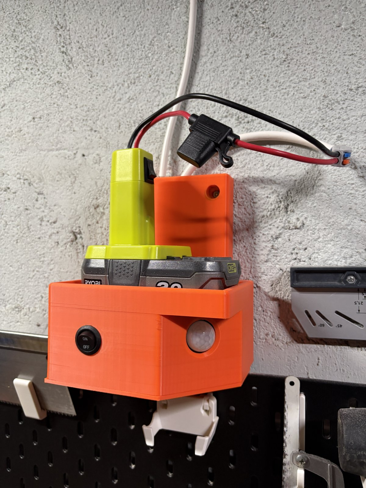
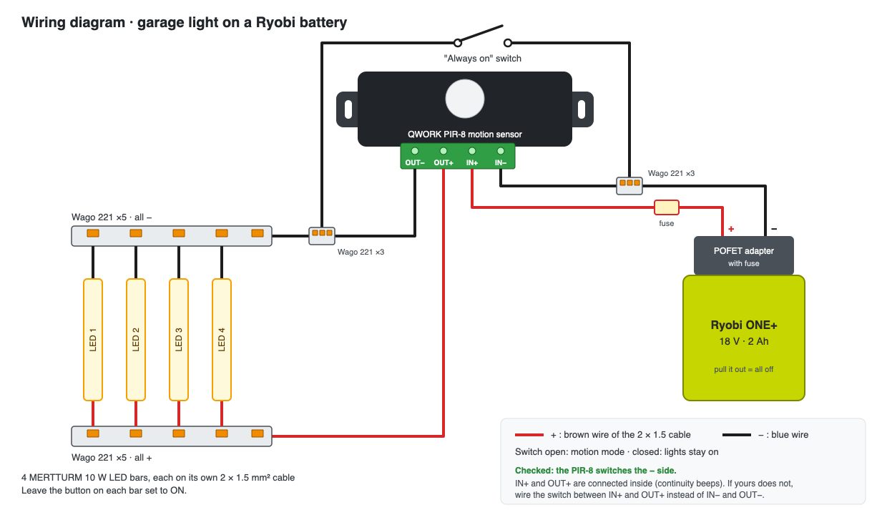
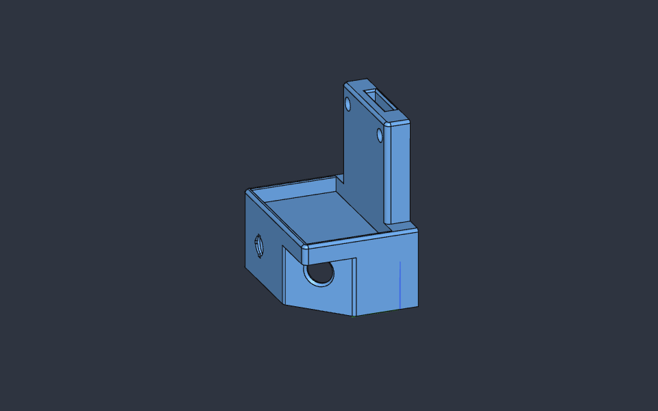
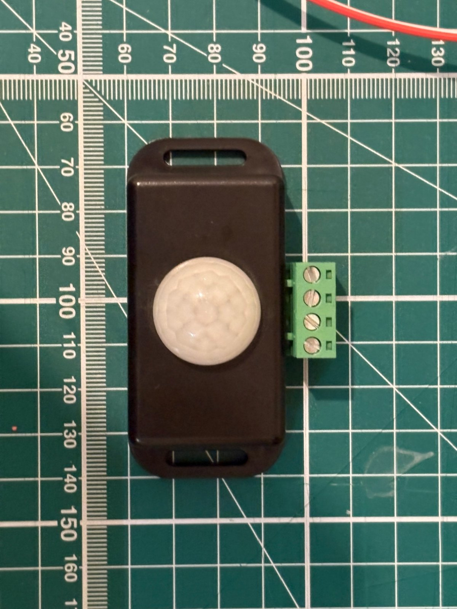
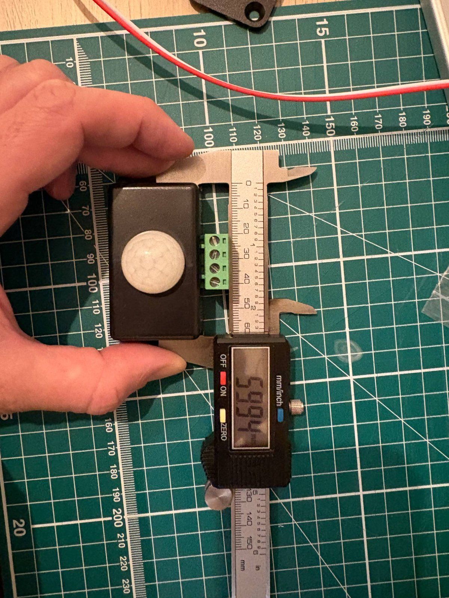
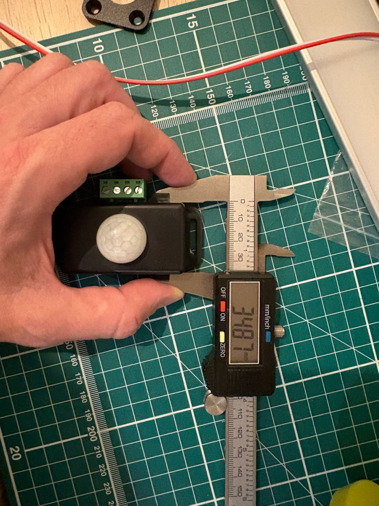
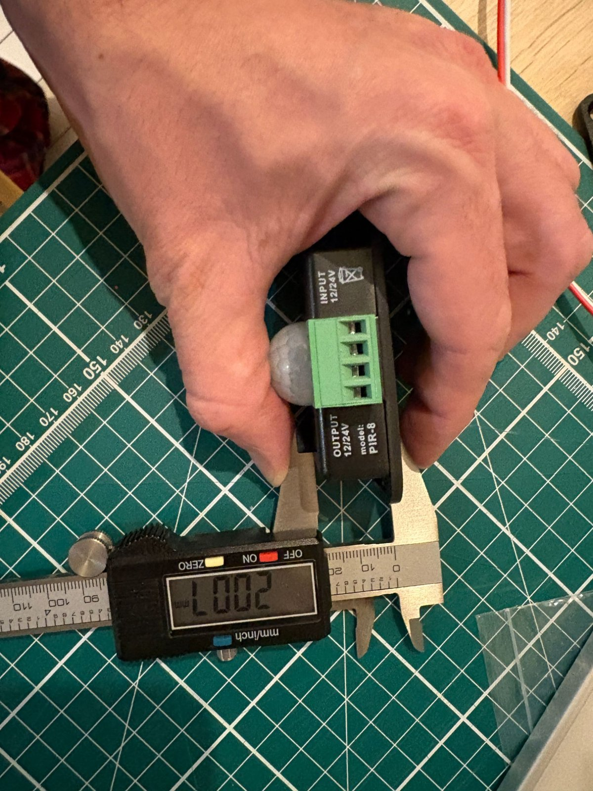
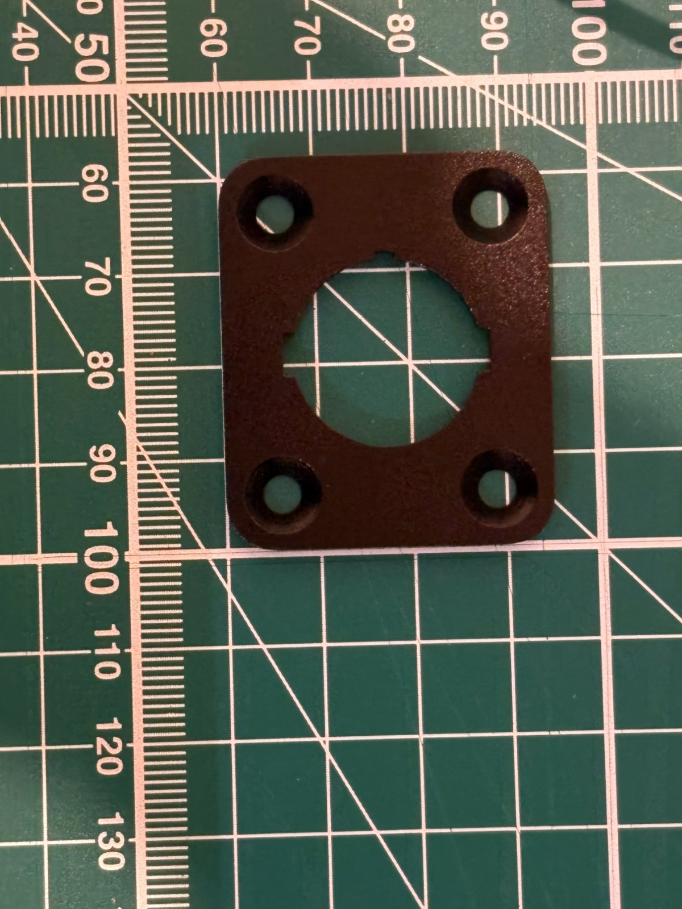
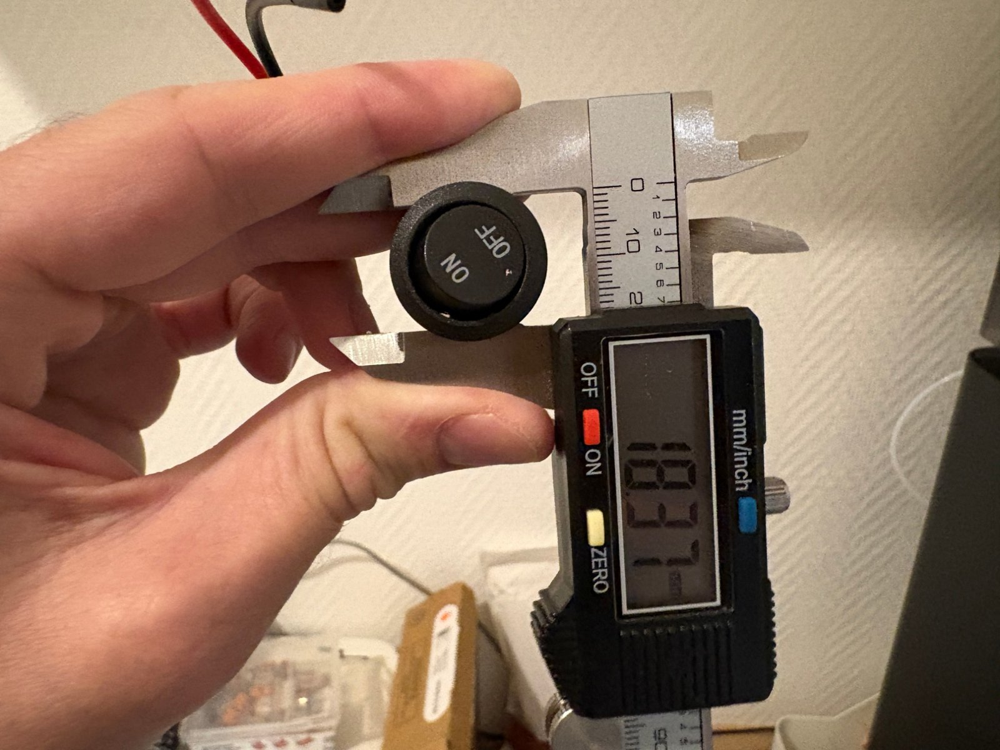

# Garage light on a Ryobi battery

Battery-powered garage lighting with a motion sensor, running on a Ryobi ONE+ 18 V battery. A 3D-printed wall box holds the battery, the sensor, an "always on" switch and the Wago connectors. Pull the battery out to switch everything off, and charge it on the regular Ryobi charger.

- No mains wiring: everything runs at 18 V DC.
- Motion mode by default, with a switch to keep the lights on.
- Cables come in from the top only, through a channel closed on the wall side so they never rub on the concrete.
- Two screws hold the whole thing to the wall.

## Parts

Prices are from Amazon.fr in November 2026, about €87 in total.

| Part | Qty | Link |
|---|---|---|
| Ryobi ONE+ 18 V battery, 2 Ah | 1 | any ONE+ battery fits |
| POFET Ryobi 18 V battery adapter, with fuse and switch | 1 | [B0CBBPVN79](https://www.amazon.fr/dp/B0CBBPVN79) |
| MERTTURM LED bar, 42 cm, 1000 lm, 10 W, 12–85 V (pack of 2) | 2 packs | [B0C3LCBV2N](https://www.amazon.fr/dp/B0C3LCBV2N) |
| QWORK PIR-8 motion sensor, 12–24 V, 6 A (pack of 2) | 1 | [B093SZRZCV](https://www.amazon.fr/dp/B093SZRZCV) |
| Gebildet round rocker switch, 2 pins, Ø18 mm (pack of 6) | 1 | [B08R5WMT6J](https://www.amazon.fr/dp/B08R5WMT6J) |
| H05VV-F twin cable, 2 × 1.5 mm², 10 m | 1 | [B01GCWXN5I](https://www.amazon.fr/dp/B01GCWXN5I) |
| Wago 221 lever connectors: two 5-way, two 3-way | 4 | hardware store |
| M3 heat-set inserts (Ø4 hole, 7 mm deep) | 7 | |
| M3 × 8 countersunk screws (hatch) | 5 | |
| M3 × 8 cap screws and washers (sensor) | 2 | |
| Ø5 × 50 countersunk wood screws and 6 mm wall plugs | 2 | |

## Wiring

Battery → adapter (fuse) → sensor input → sensor output → Wago → 4 LED bars in parallel.

The PIR-8 terminal block, from left to right with the dome up: **OUT− · OUT+ · IN+ · IN−**.

- The adapter's + goes to IN+ and its − to IN−.
- OUT+ feeds the 5-way Wago that carries all the + wires to the bars, OUT− the one that carries all the − wires.
- The "always on" switch sits in parallel with the sensor on the side it switches. On this PIR-8, IN+ and OUT+ are connected inside (continuity beeps), so it switches the − side: the switch goes between IN− and OUT−, through the two 3-way Wagos. If your sensor beeps between IN− and OUT− instead, put the switch between IN+ and OUT+. Either way it can't cause a short, so trying both is safe.
- Switch open: motion mode. Switch closed: lights stay on. Battery out: everything off.

Editable diagram: [`wiring/wiring-diagram.svg`](wiring/wiring-diagram.svg).

### Before you close the box

- Leave the button on each LED bar set to ON, and check they turn on by themselves when power comes back. Otherwise the sensor can't switch them on.
- Measure the sensor's standby current. Above 5–10 mA it drains a 2 Ah battery in one to two weeks.
- The sensor sees about 60°: point the 45° face at the door.

Rough battery life with a 2 Ah battery and 15 minutes of light a day: about 5 days with 2 bars, 2–3 days with 4 bars. For more, keep the bars and sensor and switch to a 12 V LiFePO4 battery.

## The box

- **Top:** a closed pocket of 137 × 83 × 15 mm that the battery drops into, with the adapter on top. Its floor (4 mm) is the ceiling of the electronics compartment.
- **Front right:** a 45° face for the motion sensor. Only the dome sticks out, through a Ø25.5 hole chamfered outwards. The sensor slides in from below between two guides, then screws onto two posts with M3 inserts through its rear tabs.
- **Front left:** the round switch. Ø18.8 hole with two notches (22 mm tip to tip) and a keying notch on the left; the wall is thinned to 2 mm so the clips catch.
- **Back:** an 18 mm wall plate up to 177 mm high, with a 49 × 9 mm cable channel closed by a 3 mm skin on the wall side. Cables enter from the top only and the channel curves (R15) into the box, so a cable pushed in from the top ends up inside on its own.
- **Wall fixing:** two Ø5 countersunk screws at the top of the plate, in Ø13 counterbores, into 6 mm wall plugs. Screw them in with the battery out.
- **Bottom:** a 3 mm access hatch held by 5 countersunk M3 screws in heat-set inserts.
- Outer edges are rounded (R5 vertical, R3 on top).

Overall size: 149 × 113 × 177 mm, plus 3 mm for the hatch.

Measurements the design is based on:

| Part | Measured |
|---|---|
| PIR-8 body | 59.94 × 34.87 × 20.07 mm |
| Switch body | Ø18.37 mm |
| Switch notches, tip to tip | 22 mm |

## Printing

| File | Material | Notes |
|---|---|---|
| [`print/garage-light-box.stl`](print/garage-light-box.stl) | PETG | print upright, as exported (open bottom on the plate) |
| [`print/access-hatch.stl`](print/access-hatch.stl) | PETG | already flipped, countersinks up, no supports |

The box only needs supports under the battery floor, inside the box and under the overhang above the sensor face, both at z = 58 mm. Everything else is 45° chamfers or short bridges.

Tree supports in Bambu Studio, with a PLA interface through the AMS so they peel off cleanly:

- Supports on, type **tree (manual)**, style Tree Hybrid or Organic, **on build plate only**.
- Top interface layers: 2. Bottom interface layers: 0. Top Z distance: 0. Top interface spacing: 0.
- Support base filament: PETG. Support interface filament: PLA. Tick *Avoid interface filament for base*.
- With the support painting tool (enforcer), paint the underside of the battery floor inside the box and the underside of the overhang above the sensor face.

Both areas are at the same height, so PLA is used on a single level: about two filament changes for the whole print. Check the sliced preview before printing. Pull the inner supports out through the hatch opening.

## CAD

- [`cad/garage-light-box.step`](cad/garage-light-box.step): box and hatch, for any CAD tool.
- [`cad/garage-light-box.sc`](cad/garage-light-box.sc): the parametric SolidCraft model (feature names are in French). Main parameters: `bL` × `bW` (battery pocket), `seat` (pocket depth), `t` / `tb` (walls), `zs` (sensor height), `chW` × `chD` (cable channel), `hT` (plate height), `swD` (switch hole). The 45° face, the sensor posts and the hatch screws use fixed coordinates, so they need moving by hand if the pocket or wall sizes change.

## License

[MIT](LICENSE). Build it, change it, share it.
